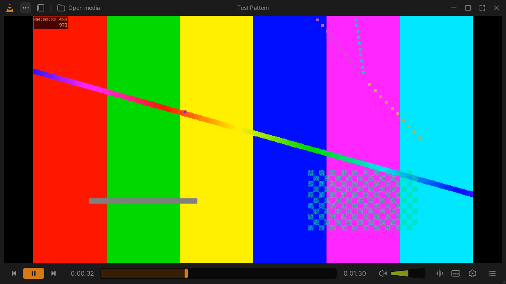

# VLC Redesign skin

A skin for VLC 3 based on Juxtopposed's redesign of VLC.

- Design: [VLC Redesign on Figma Community](https://www.figma.com/community/file/1691465999134370980/vlc-redesign)
- Video: [I Redesigned VLC After 25 Years](https://www.youtube.com/watch?v=ERFeOgqk324)

## Install

1. Download [`dist/VLC-Redesign.vlt`](dist/VLC-Redesign.vlt).
2. In VLC, open **Tools → Preferences → Interface**, choose **Use custom skin** and pick the file.
3. Save and restart VLC.

With the skin on, Preferences are under **Settings** in the ••• menu at the top left.

## What's included

- The player, in dark and light
- A playlist sidebar
- A mini player
- An equalizer
- Controls in fullscreen

The ••• menu switches theme and opens the mini player and playlist.
More [screenshots](docs/screenshots).

## Not included

A skin can only restyle VLC's player window. Settings, dialogs and menus keep VLC's own look,
and the design's library views don't exist in VLC 3. [docs/notes.md](docs/notes.md) has the details.

## Building

`python build.py` regenerates `dist/`. It needs Python 3 with Pillow and fontTools.
[docs/notes.md](docs/notes.md) explains how it works.

## Credits and license

- **Design:** ["VLC Redesign"](https://www.figma.com/community/file/1691465999134370980/vlc-redesign) by Juxtopposed, licensed under
  [CC BY 4.0](https://creativecommons.org/licenses/by/4.0/). This skin adapts it for VLC 3. The
  icons are cut from the design; the images in `dist/`, `docs/screenshots/` and `reference/figma/`
  are derived from it and shared under the same license.
- **Font:** [Inter](https://github.com/rsms/inter) by the Inter Project Authors, under the SIL Open
  Font License ([fonts/Inter-LICENSE.txt](fonts/Inter-LICENSE.txt)). The playlist uses a modified
  copy, renamed Inter Rows.
- **Code:** `build.py`, `skinlib/` and `tools/` are dedicated to the public domain under
  [CC0 1.0](LICENSE). CC0 covers only the code: the design and Inter keep the licenses above.

This is an unofficial skin, not affiliated with or endorsed by VideoLAN. VLC and the VLC cone are
trademarks of VideoLAN.
